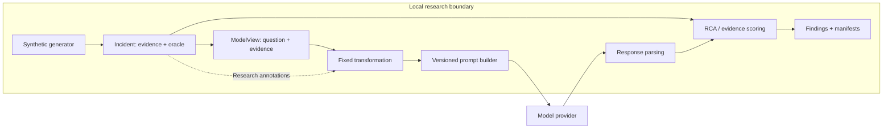

# DiagPriv

**Privacy-aware evidence transformation for LLM-assisted root-cause analysis.**

[](pyproject.toml) [](https://doi.org/10.5281/zenodo.23142444) [](docs/benchmark_spec.md)

**Give AI the problem without giving it the person.**

Operational logs and database records often contain sensitive identifiers alongside the relationships an AI assistant needs to investigate an incident. Removing those identifiers indiscriminately can destroy evidence needed to understand the failure.

DiagPriv studies how privacy-oriented transformations affect diagnostic utility. Its companion benchmark, **DiagBench**, uses three synthetic incident families to evaluate identifier linkage, reference structure and temporal reasoning. This is the public research and reproducibility snapshot, not a deployed enterprise privacy gateway.

**[Read the preprint](https://doi.org/10.5281/zenodo.23302664)** · [Architecture](docs/ARCHITECTURE.md) · [Benchmark](docs/benchmark_spec.md) · [Reproduce the software checks](#reproduce-the-software-checks)

## The idea in 30 seconds

Suppose an engineer needs to investigate whether two successful payment effects originated from the same request. The original identifiers are unnecessary for this question, but their equality and the distinctness of the effects matter.

| Original synthetic evidence | Illustrative pseudonymized evidence |
| --- | --- |
| Request: REQ-101, Effect: PAY-01, Status: SUCCESS | Request: R_A, Effect: E_A, Status: SUCCESS |
| Request: REQ-101, Effect: PAY-02, Status: SUCCESS | Request: R_A, Effect: E_B, Status: SUCCESS |

An AI assistant can still see that one request is associated with two distinct successful effects. Replacing all identifiers with the same placeholder could lose that distinction.

*Illustration only: invented records and shortened example tokens, not actual HMAC output, an experimental result, or proof of a root cause. Pseudonymization retains relationships and may still disclose sensitive information.*

## Research architecture



The evaluated model receives the rendered question and transformed evidence, not the complete oracle-bearing Incident. Research-only annotations drive the fixed transformations; expected diagnoses and invariant checks remain on the local evaluation side. This is the published benchmark architecture, not autonomous task-aware selection.

## Engineering highlights

| Area | Public implementation |
| --- | --- |
| Data engineering | Deterministic synthetic generators, structured evidence schemas, oracle/model-view separation |
| Privacy engineering | Redaction, HMAC, tokenization, format-preserving pseudonymization and relative-time transformation |
| AI infrastructure | Versioned prompts, provider abstraction, response parsing and RCA/evidence-support scoring |
| Reliability | Offline fake provider, regression and leakage tests, configuration hashes and reproducible paper tables |
| Research | Matched incident contrasts and multidimensional representation-exposure analysis |

**Stack:** Python, pytest, uv, JSON/JSONL, TOML, LaTeX and Git.

## Selected findings

Small, controlled **synthetic development** experiments illustrate why diagnostic structure matters. These observations are descriptive, not a universal transformation ranking or proof of anonymity.

| Incident family | Diagnostic dependency | Selected development observation |
| --- | --- | --- |
| 001 — duplicate payment | Identifier linkage | Raw, HMAC and tokenization each achieved 5/5 exact RCA; redaction and format-preserving each achieved 4/5. |
| 002 — reference structure | External-reference format | Raw: 15/18 correct triggers and mechanisms; format-preserving: 10/18; redaction: 2/18; HMAC: 1/18; tokenization: 2/18. See the separate transport-recovery sensitivity comparison. |
| 003 — temporal contrast | Causal temporal relationships | Both mechanisms correctly distinguished in 3/4 matched pairs with raw evidence, 2/4 with relative time, and 0/4 with temporal ablation. |

See the [paper results tables](docs/PAPER_RESULTS_TABLES.md), [transport-recovery analysis](docs/INCIDENT_002_TRANSPORT_RECOVERY.md), and [exposure analysis](docs/PRIVACY_EXPOSURE_ANALYSIS.md) for definitions and limitations.

<details>
<summary><strong>Detailed frozen research status</strong></summary>

| Condition | Split | Status | Result |
|---|---|---|---|
| Raw, `raw-rca-v2` | Development 1000–1004 | Frozen | 5/5 exact RCA; 5/5 overall |
| Raw, `raw-rca-v2` | Validation 2000–2009 | Frozen | 10/10 exact RCA; 9/10 overall |
| `redaction-v1` | Development 1000–1004 | Frozen | 4/5 exact RCA; 4/5 overall |
| `hmac-v1` | Development 1000–1004 | Frozen | 5/5 exact RCA |
| `tokenization-v1` | Development 1000–1004 | Frozen | 5/5 exact RCA |
| `format-preserving-v1` | Development 1000–1004 | Frozen | 4/5 exact RCA |

Incident Family 002 is a reviewed synthetic benchmark in which reference
structure is deliberately necessary to diagnose a missing provisioning effect.
Its six-seed, five-condition, three-trial development comparison and separate
transport-recovery sensitivity analysis are complete and frozen. Raw achieved
15/18 correct triggers and failure mechanisms; format-preserving-v1 achieved
10/18; redaction-v1, HMAC-v1, and tokenization-v1 achieved 2/18, 1/18, and 2/18
respectively. These are directional development observations, not causal or
general conclusions. No Incident 002 validation or held-out observation exists.


Incident Family 003 v3 is a matched target/temporal-twin benchmark designed
after an earlier temporal construction was shown to contain non-temporal
shortcuts. Four frozen constructions are queried under raw, relative-time, and
temporal-ablation evidence. Paired mechanism discrimination is 3/4 under raw,
2/4 under relative time, and 0/4 under ablation. Target mechanisms remain 4/4
in all three conditions; the degradation occurs on the twins, which collapse
to the target's concurrency mechanism under ablation. This is a small
directional development observation, not a provider-level causal estimate or
evidence of general temporal-reasoning performance. No Incident 003 validation
or held-out observation exists.

Family 001's raw-only validation observation is not a matched privacy comparison.

</details>

## Reproduce the software checks

Python 3.12 or newer and [uv](https://docs.astral.sh/uv/) are recommended.

```bash
git clone https://github.com/keshavlikhar/diagpriv-public.git
cd diagpriv-public
uv sync --extra dev
uv run pytest
git diff --check
uv run python paper/render_tables.py --check
```

The manuscript source is under `paper/`. With a TeX distribution that
provides `latexmk` and the packages used by `paper/main.tex`, build from
`paper/` with:

```bash
latexmk -pdf -interaction=nonstopmode -halt-on-error -outdir=build main.tex
```

The frozen-artifact verifier is provider-free:

```bash
uv run python -m diagpriv.artifacts verify --all
```

In an ordinary clean clone the exact provider-result JSONLs are intentionally
absent, so exit code 2 with `MISSING` entries is expected. The verifier does
not download or rerun provider observations.

Tests use an offline fake provider. They do not authorize real API calls. The
canonical development fixture can be regenerated with:

```bash
uv run python -m diagbench.generators.incident_001 --seed 1001
uv run python -m diagbench.generators.incident_002 --seed 1001
```

**Reproducibility level:** Level 1 — tracked source, configurations, deterministic generators/analyses, aggregate data, generated paper assets, hashes and offline verification. Level 2 exact-byte private provider-observation archive is not provisioned; Level 3 public observation-level reproduction is unavailable. Software checks are not independent reproduction of provider observations.

## Explore the code

| Path | Purpose |
| --- | --- |
| [`diagbench/`](diagbench/) | Synthetic incident schemas, generators and fixtures |
| [`diagpriv/transformations/`](diagpriv/transformations/) | Fixed privacy-oriented transformations |
| [`diagpriv/invariants/`](diagpriv/invariants/) | Offline diagnostic-invariant checks |
| [`diagpriv/evaluation/`](diagpriv/evaluation/) | Prompting, provider interfaces, parsing, scoring and reporting |
| [`diagpriv/privacy/`](diagpriv/privacy/) | Representation-exposure analysis |
| [`diagpriv/artifacts/`](diagpriv/artifacts/) | Frozen-artifact verification |
| [`experiments/`](experiments/) | Versioned research configuration |
| [`tests/`](tests/) | Benchmark, protocol and transformation regression tests |
| [`paper/`](paper/) | Manuscript, generated results and supporting materials |

Start with the [architecture](docs/ARCHITECTURE.md), [research plan](docs/RESEARCH_PLAN.md), [benchmark specification](docs/benchmark_spec.md), and [contributing guide](CONTRIBUTING.md).

## Publication and authors

**DiagPriv: Preserving Diagnostic Structure While Reducing Sensitive Data Exposure in LLM Root-Cause Analysis**

Keshav Likhar, Harsh Mandalgi, and Mohit Chaturvedi — independent researchers. All three authors contributed equally; Keshav Likhar is the corresponding author.

- Revised preprint: [10.5281/zenodo.23302664](https://doi.org/10.5281/zenodo.23302664).
- Original October 4, 2026 preprint and reproducibility archive: [10.5281/zenodo.23142445](https://doi.org/10.5281/zenodo.23142445).
- All versions: [10.5281/zenodo.23142444](https://doi.org/10.5281/zenodo.23142444).
- Citation metadata: [`CITATION.cff`](CITATION.cff).

Published as a research preprint, not a peer-reviewed paper. Historical manuscript metadata in this snapshot may refer to the original release.

## Research boundaries and licensing

All benchmark incidents are synthetic. No production or customer records are used in the study. Do not rerun frozen experiments, inspect protected held-out seeds, or run new provider experiments without explicit research authorization. Never commit credentials or secret keys.

DiagPriv does not establish anonymization, legal compliance, differential privacy, data-residency enforcement or production effectiveness. Exposure measurements characterize visible properties; they are not a universal privacy score.

The [original publication metadata](paper/ZENODO_PREPRINT_METADATA.md) identifies the software license as Apache-2.0 and the preprint as CC BY 4.0; the licenses are separate. This public snapshot does not currently include standalone software license files. Consult the published artifact's license terms before redistribution or reuse.
